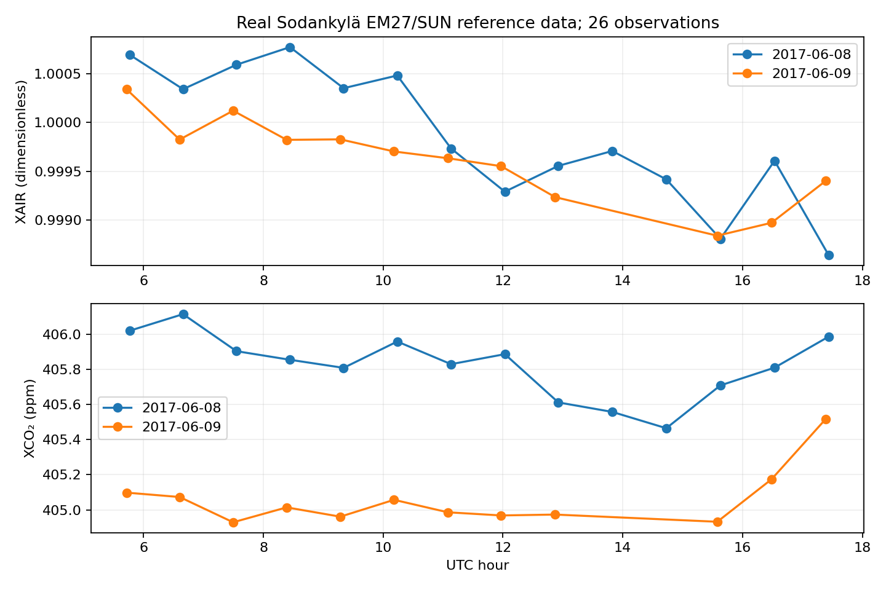

# EM27/SUN reference-data audit and quality control

**Miranda Nkwikah Finjap** · Independent reproducible portfolio study · October 2026

Audit actual reference gas columns, reproduce the documented corrections needed to recover dry-air mole fractions from gas/O2 column ratios and demonstrate sequential XAIR screening.

## Run

Use Python 3.11 or newer. From this repository directory:

```bash
python -m venv .venv
source .venv/bin/activate
pip install -r requirements.txt
python analysis.py
python -m unittest discover -s tests -v
```

Windows activation: `.venv\Scripts\activate`. Data required for the main analysis
are bundled, so the analysis runs without downloading large files.

Open [notebook.ipynb](notebook.ipynb) in Jupyter or Google Colab to read the executed
walkthrough. When using Colab, upload/extract the entire repository and change to
its directory before running the notebook. `analysis.py` is the runnable source.

## Evidence and outputs

See [results/metrics.json](results/metrics.json) for measured results, `results/`
for figures and CSV outputs, and [data/PROVENANCE.md](data/PROVENANCE.md) for
sources, units and the distinction between observations and demonstrations.
Tests target scientific failure modes, rather than merely checking that files exist.

## Findings from the completed run

All 26 real reference records pass the demonstrated XAIR screening. One deliberately injected 0.005 XAIR anomaly is rejected in a separate synthetic experiment. The simple CO2/O2 ratio differs from reported XCO2 by up to **3.877 ppm**; including the documented postprocessing corrections reduces the maximum discrepancy to **0.00130 ppm**. This is a consistency audit using rounded reference fields and supplied XH2O, not an independent spectral retrieval.



## Scope and limitations

Only 26 reference rows across two days. These are precomputed retrievals, not measurements collected here. Synthetic anomalies are identified separately. The Jinja thresholds are a methodological demonstration and require site-specific validation.

Climate/health relevance: greenhouse-gas monitoring and emissions analysis provide
climate context; none of these quantities directly estimates a person's exposure,
disease risk or health outcome.

## CV wording supported by this repository

Audited real EM27/SUN reference retrievals, reconstructed dry-air gas fractions and implemented sequential XAIR quality screening with controlled anomaly tests.

## Research ownership and review

This analysis was prepared collaboratively with coding assistance. All original
observations and published results remain credited to their data providers.
The researcher should reproduce the run, inspect the figures and understand the
methods before presenting the work in an interview or extending it for publication.
This repository is a portfolio study, not a peer-reviewed article.

Contact: miranda.finjap@aims-cameroon.org
